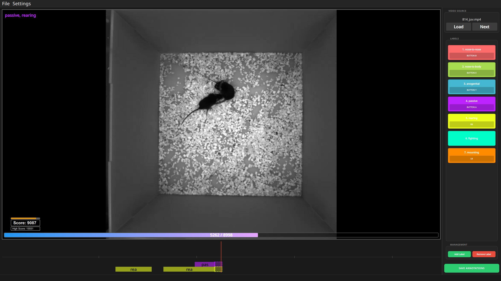

# Ethoscore : Video Behavior Annotator

Ethoscore is a video annotation tool for behavioral analysis, built with PySide6 and OpenCV. Annotate video footage with specific behaviors using keyboard, mouse, and gamepad controls.



## Features

- **Multi-Input Support**: Keyboard shortcuts, mouse, and gamepad controls to keep muscle cramps away
- **Multitrack Annotation**: Label multiple behaviors on the same frame simultaneously
- **Undo Support**: Easily revert recent annotation changes with Ctrl+Z
- **Timeline Interface**: Interactive timeline with zoom/click/drag navigation
- **Behavior Annotation**: Label frames with customizable behaviors
- **Optional Gamification**: Get points according to the duration of the labels and even combos if executed quickly!
- **Auto-Save**: Configurable automatic saving
- **Color-Coded Labels**: Visual behavior identification in the timeline and preview bars for previous/next frame
- **CSV Export**: Classic frame by frame matrix

## Installation

Download the **Ethoscore Setup** package for Windows, macOS, or Linux from the
[releases page](https://github.com/BelloneLab/ethoscore/releases). Setup includes
the application and dependencies, lets you choose its installation folder and
desktop / Start menu / Applications shortcuts, and can update an existing install.
Reopen Setup and choose **Download the latest official build**, then
**Update / Reinstall**. Videos, annotations, preferences, and earlier installed
versions are retained. Relaunch Ethoscore to use the new version.

Native packaging and developer build instructions are in
[installer/INSTALLATION.md](installer/INSTALLATION.md).

**Run from source**: Python 3.12 and pip are recommended. Use a dedicated environment.

**Install dependencies**:
```bash
pip install -r requirements.txt
```

**Run**:
```bash
python ethoscore.py
```

## Multiple arenas in one recording

1. Open a video and select **Set up arenas** in the right sidebar or **Arenas** menu.
2. Choose **Auto-detect arenas** to propose crops from stable dividers. Review the
   proposals. If the layout is irregular or detection finds no reliable dividers,
   drag rectangles over the source preview or create a grid with your chosen row
   and column counts. Edit names and pixel coordinates in the table.
3. Select **Export arenas**. A background FFmpeg job decodes the source once and
   writes all crops. The original recording is never edited. Export can be
   cancelled; partial crops are not published.
4. Select an arena using the dropdown or previous / next buttons. **Only that
   arena's subvideo is displayed and annotated.** Switching saves the current
   arena and restores the other arena's frame position. Annotations, undo history,
   and held labeling controls cannot cross into another arena.
5. Track progress with **Unlabeled** (gray), **Ongoing** (amber), and **Completed**
   (green). Completion is an explicit decision, including arenas with no events.
   Editing a completed arena returns it to Ongoing.

The source's arena project reopens automatically when you reopen the recording.
You can rename exported arenas using **Manage arena names**. Crop geometry is
fixed after export to protect existing annotations. Original CSVs belonging to
the full video stay separate from arena CSVs.

Outputs sit next to the source in a dedicated folder:

```text
recording_arenas/
  arenas.json                # Source identity, crop geometry, names, progress
  arena_1/
    video.mkv                # Only this arena, every original frame in order
    video.csv                # Independent annotations, Frames starts at 1
    arena.json               # Crop and verified encoding metadata
  arena_2/
    video.mkv
    video.csv
    arena.json
```

The CSV appears when an arena is first saved or switched away from. Custom arena
names do not change the stable folder identifiers or break saved annotations.
Existing exported videos are never overwritten. A source fingerprint detects
accidental source replacement before a project is reopened.

Cropping uses FFmpeg's `crop` filter and frame passthrough, with no frame-rate
conversion. Every source and exported crop is decoded to verify exact frame
counts before publication; fractional nominal frame rates and odd crop dimensions
are checked too. Output contains video only. The default H.264 ultrafast encoding
is fast and visually high quality. **Lossless crops** uses lossless YUV encoding;
conversion between RGB and YUV can still change RGB values slightly. Variable-rate
movies retain frame count and order; the existing time-based annotation statistics
use the video's nominal frame rate.

Automatic detection is a proposal tool for straight, dark arena dividers. It does
not identify animals or guarantee arena boundaries. Manual rectangles and explicit
grids cover layouts without clear divider evidence. Pixel coordinates can be
adjusted before export. See the official [FFmpeg crop documentation](https://ffmpeg.org/ffmpeg-filters.html#crop)
and [frame passthrough options](https://ffmpeg.org/ffmpeg.html).

## Validation and performance

Run the integrity and GUI regression checks with:

```console
python -m unittest discover -s tests -v
python -m unittest installer.test_backend -v
```

The GUI tests run offscreen with isolated settings and generated videos. They
cover per-arena CSV isolation, frame restoration, statuses, manual drawing,
failed saves, malformed annotations, unreadable videos, and cached/direct frame
identity. Installer tests cover fresh installs, repeat-run updates, checksums,
shortcut targets, failed updates, and preservation of user files. After building,
`python -m installer.native_smoke` tests the actual packaged setup, repeated
installation, and the installed application's two-arena annotation workflow.

Reproduce the crop benchmark and visual checks:

```console
python -m tests.test_arena_backend --benchmark
python tools/plot_export_benchmark.py
python tools/preview_arena_workflow.py
```

Benchmark CSVs, PNG/PDF/SVG figures, and UI previews are written under ignored
`tests/artifacts/`. Plotting requires Matplotlib in the environment used for that
optional report. On one Windows workstation, three paired synthetic trials
(180 frames, 640 x 480, 30000/1001 fps, four crops, including exact validation)
gave median times of **2.17 seconds shared decoding** versus **4.66 seconds for
four sequential exports**, a **2.15x** ratio. This describes that workload, not a
universal performance guarantee. Long movies, storage speed, codec, and image
dimensions affect the result.

## Usage

1. Launch the application
2. Select a video file (MP4, AVI, MOV, MKV, WMV)
3. Label frames using behavior buttons or keyboard shortcuts
4. Navigate with arrow keys, mouse or gamepad
5. Annotations auto-save as CSV files

### Keyboard controls
- **Arrow Keys**: Navigate frames
- **Shift + Arrows**: Jump larger increments (configurable)
- **Number Keys**: Toggle behaviors
- **Escape**: Remove labels
- **Ctrl+Z**: Undo last action
- **Ctrl+S**: Save
- **Ctrl+O**: Load video
- **Ctrl+N**: Load next video

### Mouse controls
- **Timeline dragging**: Move through frames
- **Left click on label**: extend the label to the actual frame (left or right)
- **Right click on label**: delete the label / delete the section of the label until the actual frame

### Gamepad
- **Left Analog Stick**: Frame navigation
- **Buttons**: Fully mappable to behaviors, erasing, undoing, or fast-forwarding using the in-app mapping utility

### Settings
- **Input Settings**: Keyboard shortcuts and advanced controller mappings (deadzones, sensitivity)
- **General Settings**: Auto-save, UI preferences, Multitrack toggle
- **Rescan Controllers**: If you controller was disconnected, relink it here instead of restarting ethoscore

## Data Format

Annotations are saved as CSV files named after your video. 

**Pro Tip:** Any annotation CSV can be used as a **Behavior Template** via `File > Load Behaviors`. This will automatically set up your behavior buttons using the CSV's column headers.

### CSV Example:
```
Frames,nose-to-nose,nose-to-body,anogenital,passive,rearing,fighting,mounting
1,0,0,0,0,0,0,0
2,1,0,0,0,0,0,0
...
```

- **Frames**: 1-based frame numbers
- **Behavior Columns**: Binary indicators (1=present, 0=absent)

## Roadmap

- Selective erasing in multitrack mode for controllers
